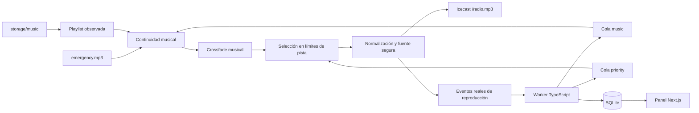

# Arquitectura

Liquidsoap mantiene el reloj de audio, Icecast distribuye MP3 estéreo a 128 kbps y el worker prepara contenidos sin estar en el camino de los frames de audio. Next.js muestra estado y ejecuta acciones administrativas. Prisma persiste catálogo, cola, historial, jobs y estado en SQLite; el audio permanece en el filesystem.

`music` es una cola interactiva que recibe la selección ponderada del backend. Cuando se vacía, `storage/music-playlist.m3u`, observada por Liquidsoap, continúa por sí misma en orden aleatorio. El scanner actualiza atómicamente ese fichero con pistas habilitadas, presentes y válidas de `storage/music`; no necesita reiniciar el motor. El bootstrap crea la lista inicial solo si no existe. Si no hay ficheros reproducibles, se usa `storage/fallback/emergency.mp3`. La normalización dinámica básica y `mksafe` protegen la salida; no se pretende hacer mastering EBU R128 de todo el catálogo.

`priority` contiene locuciones y jingles. El fallback superior es sensible a límites de pista y espera a la transición de la canción. El crossfade está dentro de la rama musical; los ficheros de voz no pasan por él. La conexión a Icecast reintenta automáticamente y systemd reinicia procesos que terminan con error.

## Contrato de comandos

El servidor de comandos de Liquidsoap no tiene autenticación: queda limitado a `127.0.0.1`, configurable únicamente en puerto mediante `LIQUIDSOAP_PORT`. El cliente abre una conexión con timeout, envía una línea y lee la respuesta hasta una línea `END`. Los comandos de cola nativos son:

| Comando                                      | Respuesta                                                  |
| -------------------------------------------- | ---------------------------------------------------------- |
| `music.push <URI>` / `priority.push <URI>`   | ID numérico de request                                     |
| `music.queue` / `priority.queue`             | IDs separados por espacios                                 |
| `music.remove <ID>` / `priority.remove <ID>` | `Done.`                                                    |
| `request.metadata <ID>`                      | Metadatos del request                                      |
| `radio.skip`                                 | `Done.`; salta la fuente actualmente emitida               |
| `radio.health`                               | JSON `{ok:true,uptimeSec:number}`                          |
| `radio.current`                              | Snapshot JSON actual o `null`                              |
| `radio.events`                               | Array JSON de los últimos 256 snapshots, orden cronológico |

El adaptador acepta únicamente rutas locales bajo storage y construye un URI `annotate:` con `queue_item_id`, `type`, `title` y `artist`. Escapa metadatos y rechaza saltos de línea para impedir inyección de comandos. La cola del motor contiene IDs de requests; la cola lógica en SQLite mantiene IDs estables y deduplicación.

El callback `on_track` está después de los operadores de audio. Cada inicio realmente emitido produce `{eventId, queueItemId, requestId, path, title, artist, startedAt, type}`. `eventId` combina un identificador de arranque con una secuencia; no se reutiliza tras reiniciar el motor. Los eventos son un buffer acotado no destructivo, para que el polling no robe eventos a otros lectores. El worker usa IDs únicos en SQLite para reconciliar relecturas. **Enviar un push no significa PLAYED**: ese estado se confirma desde el evento real. Un worker parado demasiado tiempo puede perder eventos más antiguos que el buffer; no se fabrican reproducciones desconocidas.

## Fallos y límites

`startedAt` se construye explícitamente con `time.utc()` y sufijo `Z`, evitando depender del offset local de `time.string`. La prueba de protocolo compara el evento de una locución realmente emitida con el reloj UTC. El 15 de octubre de 2026 se corrigió un desfase de una hora en el boot de demostración anterior, conservando backup SQLite y auditoría detallada en `storage/tmp/timezone-repair-20261015T105438Z.*`; no se eliminó historial.

Los proveedores de texto, voz, noticias y tiempo tienen interfaces, timeout y variantes degradadas. El trabajo horario tiene una clave única que incluye la hora y su offset para distinguir las dos horas repetidas al terminar el horario de verano. El scanner no altera los ficheros originales y deshabilita los que faltan o no se pueden decodificar. Si el worker o SQLite caen, Liquidsoap sigue emitiendo desde sus fuentes locales.

El MVP tiene un nodo y SQLite local. Reiniciar Liquidsoap pierde sus colas en memoria; el worker reconcilia identidades estables y trata los envíos ambiguos como inciertos antes de abandonarlos, evitando reencolarlos a ciegas. El audio de continuidad no depende de esa recuperación. No hay Docker, Redis ni proceso PCM alojado en Next.js.

La instalación validada usa Liquidsoap 2.4.6 oficial para Noble, Node 24.21.0 e Icecast 2.4.4. Systemd supervisa cuatro unidades nativas: `radio-liquidsoap`, `radio-worker` y `radio-web` como usuario `radio`, e `icecast2` como `icecast2:icecast`, con su PID real y reinicio ante fallo. En WSL una sesión oculta de continuidad mantiene abierta la distribución; Windows debe permanecer despierto. Los helpers no sustituyen systemd ni constituyen disponibilidad 24/7.

La aceptación de continuidad se registra mediante el decoder real de `scripts/soak-stream.sh`: duración objetivo, progreso, errores y resultado final quedan en disco. Una ejecución iniciada sigue pendiente hasta completar ocho horas. La generación externa con voz real requiere una clave válida y cuota; la prueba con clave inválida verifica degradación y continuidad, no calidad de voz ni acceso a un proveedor.
